# mix 架构基线：现状与适度演进目标

- 日期：2026-10-29
- 状态：设计稿（已过独立评审，待作者确认）
- 读者：项目作者与未来协作者

## 1. 目的与边界

**目的**：给整个项目拍一张全景基线，说明「有哪些部分组成、它们如何协作、边界在哪里」，并在此基础上给出一个**不更换技术选型**的适度演进目标，供后续决策与实施参照。

**非目标**：

- 不是实施计划。具体任务拆分由后续计划文档承担。
- 不更换框架与基础设施：继续使用 Next.js 16、React 19、Bun、Sequelize + SQLite、antd 6、pm2。
- 不包含 monorepo 改造、多租户改造、容器化/集群化。

**判断依据**：本文所有「现状」描述均来自当前代码；「目标」部分属于建议，标注为演进方向，不代表已排期。

**推进范围**：四个阶段（Phase 0–3）一起进入后续实施计划，但按 §11 的顺序逐阶段交付，每阶段可独立合并与部署，不影响生产可用性。

---

## 2. 系统上下文（现状）

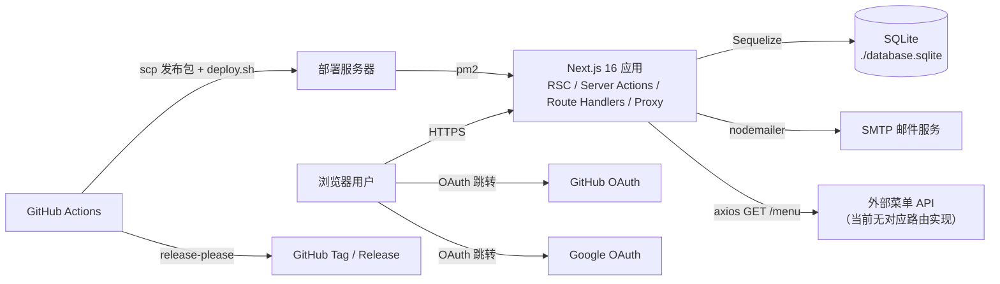

组成说明：

| 组成           | 职责                                 | 现状                                                |
| -------------- | ------------------------------------ | --------------------------------------------------- |
| Next.js 应用   | 页面、Server Actions、少量 API Route | App Router，全部源码在 `src/`                       |
| SQLite         | 唯一持久化存储                       | `./database.sqlite`，无迁移，靠 `sync` 建表         |
| next-auth      | 登录与会话                           | 数据库会话 + 自定义 Sequelize adapter               |
| CASL           | 授权规则引擎                         | 存在两套能力构建路径（见 §6）                       |
| antd 6         | UI 组件库                            | 已接入 cssinjs SSR、主题与中文 locale               |
| GitHub Actions | 检查、发布、部署                     | 三条工作流：`ci.yml` / `release.yml` / `deploy.yml` |
| pm2            | 进程守护                             | 单机单进程，端口 8085                               |
| 外部菜单 API   | 侧边栏菜单数据                       | `MenuService` 请求同源 `/menu`，仓库内没有该接口    |

> 外部菜单 API 属于历史遗留：`src/services/menu.ts` 通过 axios 请求 `/menu`，但 `src/app/api` 下只有认证与 `rsc` 两个路由。

---

## 3. 代码分层（现状）

### 3.1 目录职责

| 目录                                | 职责                            | 备注                                                                |
| ----------------------------------- | ------------------------------- | ------------------------------------------------------------------- |
| `src/app`                           | 路由、页面、布局、Route Handler | Server Component 为主，`dashboard` 布局是客户端组件                 |
| `src/actions`                       | Server Actions                  | 入参校验 → 能力判断 → 调用模型/服务 → `revalidatePath` / `redirect` |
| `src/services`                      | 业务服务                        | `auth`、`ability`、`role`、`menu`、`mailer`                         |
| `src/models`                        | Sequelize 模型                  | 含关联、种子、部分权限模板                                          |
| `src/lib`                           | 基础设施                        | `sequelize`、`casl`、`axios`、`otp`、`antd` 注册器                  |
| `src/components`                    | 通用 UI                         | 布局、表格、表单、验证码、邮箱模板等                                |
| `src/store`                         | Redux Toolkit                   | `app`（侧边栏折叠）、`menu`                                         |
| `src/hooks` `src/utils` `src/types` | 通用 hooks / 工具 / 类型        |                                                                     |
| `src/zod`                           | 表单校验与 antd 桥接            |                                                                     |
| `src/styles` `src/assets`           | 样式与静态资源                  | SCSS Modules + 主题 token                                           |
| `tests` `scripts`                   | 测试辅助、种子与部署脚本        |                                                                     |

### 3.2 依赖关系（现状）

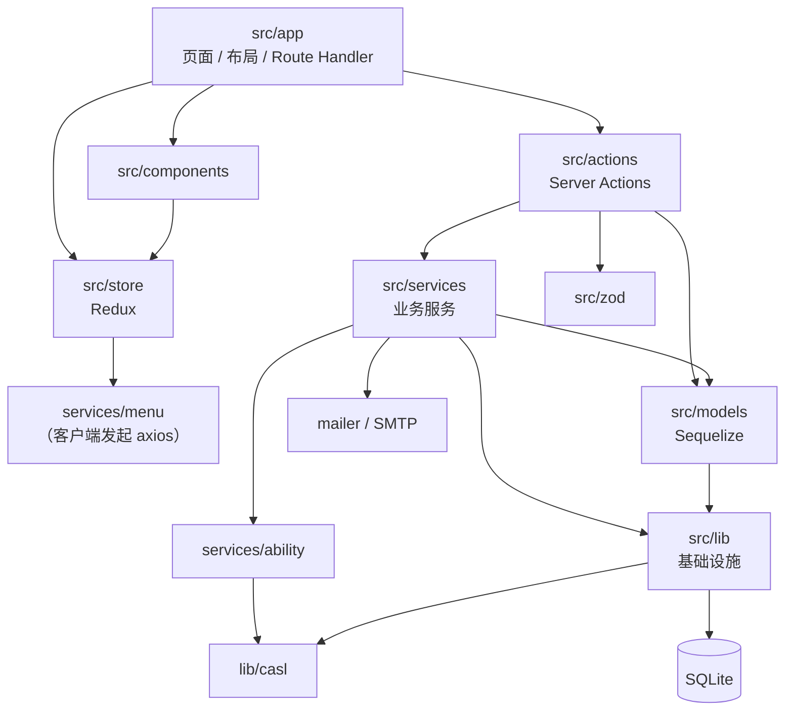

观察到的跨层与耦合：

1. `actions` 直接操作 `models`（如 `src/actions/role.ts` 直接使用 `Role`、`Permission`），没有经过 `services`。
2. `lib/sequelize.ts` 反向依赖 `@/models` 的类型，并在 `BaseModel` 上挂载 `accessibleBy`；基础设施层知道领域模型。
3. `services/ability` 与 `lib/casl` 通过类型互相引用（类型导入会被擦除，不是运行时循环，但方向不干净）。
4. `store/slices/menu.ts` 直接调用 `services/menu`，业务服务被客户端状态层消费。
5. `models` 内部承载了种子数据（`Role.afterSync`）和权限模板（`Role.permission`），数据层同时承担了策略定义。

---

## 4. 运行时链路（现状）

### 4.1 页面渲染（RSC）

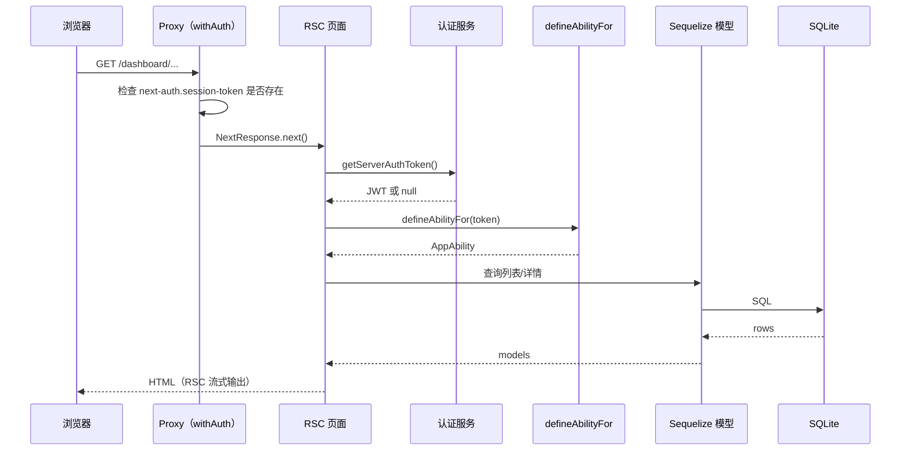

注意：`src/proxy.ts` 的 `config.matcher` 是 `['/dashboard/:path*']`，因此中间件只覆盖 `/dashboard` 下页面；`/api`、`/profile`、`/mail`、`/dev`、`/rsc` 等路径不经过中间件。`authorized` 回调只判断 session cookie 是否存在，不判断角色。

### 4.2 Server Action 写入

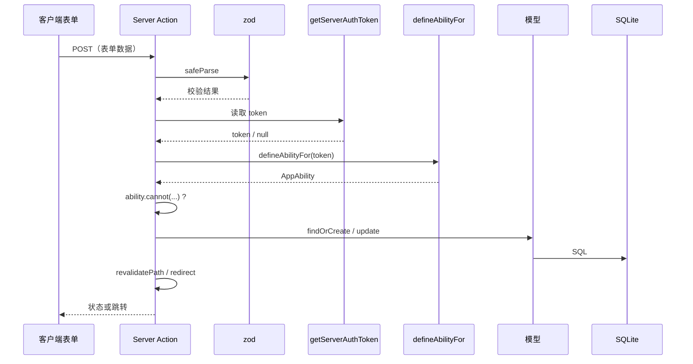

现状断点：`defineAbilityFor` 按 `token.role` 查静态角色表，但 `token.role` 从未被写入（`src/services/auth/index.ts:185` 的赋值被注释），因此业务代码里的能力判断实际上永远得到空能力。

### 4.3 认证

- 入口：`/signin`（账号密码、邮箱验证码、GitHub、Google）。
- 会话：`strategy: 'database'`，token 由 `randomUUID` 生成，落 `sessions` 表；credentials 登录时在 jwt 回调里手动创建 session 行。
- Adapter：`src/services/auth/adapter-sequelize.ts` 将 next-auth 的 `users/accounts/sessions/verification_tokens` 映射到模型。
- 中间件：`src/proxy.ts` 使用 `withAuth`，仅检查 cookie 存在性。

> 待实现阶段验证：在数据库会话策略下 `getToken()` 解析的是 JWT；cookie 中是 UUID 会话令牌，二者兼容性需要实测确认。

---

## 5. 数据模型（现状）

### 5.1 ER 图

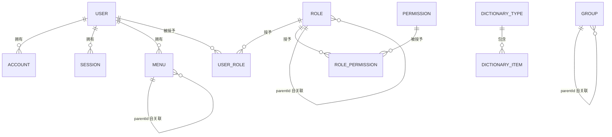

孤立模型（当前没有关联）：`ORGANIZATION`、`LOG`。

### 5.2 关键表说明

| 表                         | 关键字段                                                                                 | 说明                                                                               |
| -------------------------- | ---------------------------------------------------------------------------------------- | ---------------------------------------------------------------------------------- |
| `permissions`              | 模型：`action, subject, name, description, expires, is_builtin`                          | 权限项（能力清单）。本地库仍是旧结构（多一个 `rules` 列，缺 `expires/is_builtin`） |
| `roles`                    | 模型：`name`（唯一）、`parent_id`、`is_default`、`is_builtin`、`editable`、`defaultable` | 支持角色层级；本地库仍是最早的 `name/parent_id` 结构                               |
| `role_permissions`         | `role_id, permission_id, rules JSON`                                                     | 授予关系；模型的 `rules` 列在本地库中不存在，写入形状也不统一                      |
| `user_roles`               | `user_id, role_id`                                                                       | 多对多授予；SQLite 中已有 `(user_id, role_id)` 复合主键                            |
| `menus`                    | `user_id`、`parent_id`、`user_id` 归属                                                   | 菜单挂在用户上，而不是角色/权限上                                                  |
| `dictionaries`             | `dictionary_types` / `dictionary_items`                                                  | 通用字典                                                                           |
| `logs`                     | —                                                                                        | 暂无关联                                                                           |
| `organizations` / `groups` | `groups` 自关联                                                                          | 组织/分组尚未接入用户或角色                                                        |

### 5.3 建表与种子

- `src/lib/sequelize.ts` 定义单例；模型通过 `Model.init` 注册，关联集中在 `src/models/index.ts`。
- 没有迁移体系。`scripts/seed.ts` 执行 `sequelize.sync({ force: true })`，会销毁并重建全部表。
- 部分种子放在 `afterSync` 里（如内置角色），每次同步都会 `findOrCreate`。
- 测试通过 `tests/setup.ts` 的 `vi.mock('@/lib/sequelize')` 替换为内存库，`tests/helpers/database.ts` 在每个用例前 `sync({ force: true })`。

---

## 6. 授权子系统现状（重点）

### 6.1 两条能力构建路径

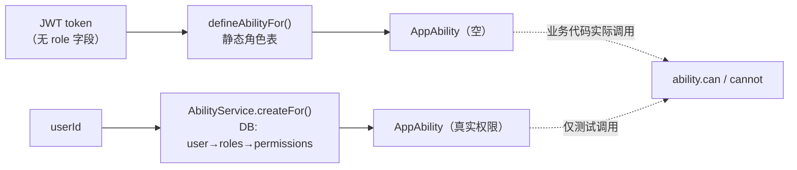

- **调用中的路径**：`src/actions/role.ts`、`src/app/page.tsx` 使用 `defineAbilityFor(token)`。
- **未被业务使用的路径**：`AbilityService.createFor(userId)` 只有 `ability.test.ts` 调用。
- 静态角色表本身存在语义问题：`member` 用 `{ id: user.id }` 约束 `Role`；`manage` 对 `all` 附加条件；带条件的规则用无实例的 `can('update', 'Role')` 判断，永远不成立。

### 6.2 数据过滤（CASL → Sequelize）

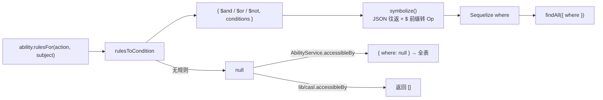

要点：

- `lib/casl.ts` 的 `toSequelizeQuery` 是官方「ability-to-database-query」示例的本地实现。
- `symbolize` 依赖 `JSON.parse(JSON.stringify())`，会丢失 `Date` / `undefined`，并误伤以 `$` 开头的业务字段。
- `AbilityService.accessibleBy`（`src/services/ability.ts:102`）把 `null` 包装成 `{ where: null }`，等于放开全部记录；`lib/casl.ts:49` 里的正确写法（`null` → 返回 `[]`）没有被任何调用方使用。
- 两处 `accessibleBy`、`findManyWithAccessible`（只有 `console.log`）都是未启用/半成品代码。

### 6.3 问题清单

| 级别 | 问题                                                                                                 | 证据                                                       | 影响                                      |
| ---- | ---------------------------------------------------------------------------------------------------- | ---------------------------------------------------------- | ----------------------------------------- |
| P0   | 业务使用的能力来源永远为空（token 无 `role`）                                                        | `src/services/auth/index.ts:185`、`src/actions/role.ts:63` | 权限判断全部失败；管理员也无法执行操作    |
| P0   | `accessibleBy` 把无规则转成 `where: null`                                                            | `src/services/ability.ts:102-104`                          | 越权读取全表                              |
| P0   | DB 授权忽略 `role_permissions.rules` 与角色层级                                                      | `src/services/ability.ts:73-97`                            | 字段/条件/继承权限失效                    |
| P1   | 内置规则语义错误（条件挂在错误 subject、无实例判断）                                                 | `src/services/ability.ts:35-47`                            | 规则误判                                  |
| P1   | `symbolize` 有损转换；inverted 规则未验证                                                            | `src/lib/casl.ts:12-26`                                    | 日期条件、拒绝规则不可靠                  |
| P1   | `permissions` 无 `(action, subject)` 唯一约束；`action/subject` 可为空                               | `src/models/Permission.ts:98-122`                          | 重复权限、脏数据                          |
| P1   | 模型与本地库结构漂移：`role_permissions.rules`、`roles.is_*`、`permissions.expires` 等列只存在于模型 | 见 §5.2；本地库由旧版 `sync` 生成                          | 线上/本地升级时缺列，`afterSync` 也不会补 |
| P2   | 权限目录三处来源（模型模板、权限表、管理页手输）                                                     | `src/models/Role.ts:149`、`src/services/permission.ts`     | 清单漂移、拼写错误                        |
| P2   | 死代码：两套 `accessibleBy`、`createAppAbility`、`with-auth` 占位                                    | 见 §6.2                                                    | 维护成本与误导                            |

---

## 7. 前端结构（现状）

- **渲染**：App Router；根布局是 Server Component，注入 `ConfigProvider`（`zhCN`、`prefixCls="mix"`、主题 token）与 cssinjs 注册器；`dashboard` 布局是客户端组件，使用 Redux 的侧边栏状态。
- **组件**：布局（header/aside）、表格、`mix-form`、`with-action-form(-modal)`、`debounce-select`、`input-checkbox-group`、`field-captcha`、邮件模板、`submitter`、`with-auth`（占位）。
- **状态**：Redux Toolkit，`app`（折叠）与 `menu`（菜单树，直接调用 `MenuService`）。
- **表单**：antd Form + `src/zod` 桥接，Server Action 返回 `ActionStatus` 与字段错误。
- **样式**：SCSS Modules + 主题 token；`next.config.ts` 已移除无用的 styled-components 编译选项。
- **实验残留**：`/rsc`、`/dev`、`/page/[id]`、`/mail`、`src/app/api/rsc`、`test.http`、`test.ts`、`icon.tsx.bak`、大量注释代码。

---

## 8. 构建、测试与发布（现状）

### 8.1 CI 与发布链路

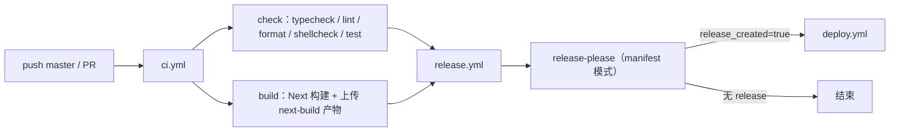

- `ci.yml` 为可复用工作流；`check` 与 `build` 并行，`build` 缓存 `.next/cache`，仅在 `upload-artifacts` 为真时上传产物。
- `release.yml` 在 master push 时运行：先跑 CI，再跑 release-please；只有真正创建 release 才进入 deploy。
- `deploy.yml` 可手动触发（从源码构建）或在发布链路中被调用（复用 CI 产物）。
- 工具链版本由 `.bun-version` / `.node-version` 固定；依赖安装走 `bun install --frozen-lockfile`。

### 8.2 部署拓扑

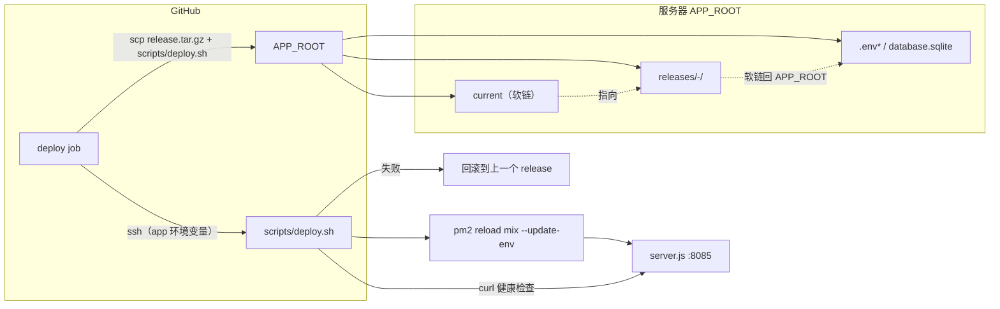

- 发布包由 `.next/standalone` + `public` + `.next/static` + `pm2.config.cjs` 组成；**不包含 `migrations/` 或迁移执行器**，服务器上只跑 `node server.js`（pm2 的默认解释器），不要求安装 Bun。
- 每个 release 独立目录，`current` 软链切换；运行态数据（`.env*`、`database.sqlite`）在 `APP_ROOT` 并软链进各 release。
- 健康检查通过 `curl` 轮询本地端口；失败自动回滚；保留最近 5 个 release。
- `RELEASES_DIR` 可覆盖；`pm2 reload --update-env` 保证环境变量刷新。
- 回滚只回退代码软链，不恢复数据库；引入迁移后必须与「切换前备份 + 只向前迁移」配合（见 §10.5）。

### 8.3 测试

- Vitest + jsdom；`tests/setup.ts` 将 Sequelize 单例替换为内存实现，模型/服务测试直接在内存库上运行。
- 当前 138 个用例，覆盖模型、Server Actions、工具函数、CASL 条件转换。
- 缺口：授权矩阵（无规则、inverted、字段级、实例条件）、Server Action 的权限分支、部署脚本的自动化测试。

---

## 9. 现状风险总表

| 类别 | 风险                                                            | 后果                       |
| ---- | --------------------------------------------------------------- | -------------------------- |
| 安全 | 能力为空 / `where: null` / 规则丢失                             | 越权或全员无权             |
| 数据 | 无迁移、`sync({ force: true })` 种子脚本、缺唯一约束            | 升级困难、误执行即全表重建 |
| 结构 | actions 直连 models、lib 反向依赖 models、服务被 store 直接消费 | 边界模糊，改动连锁         |
| 运维 | 单机 SQLite、无备份策略、无监控指标                             | 磁盘/并发故障后恢复困难    |
| 代码 | 实验页面、死代码、两套授权入口                                  | 误导后续开发               |

---

## 10. 适度演进目标（不更换技术栈）

### 10.1 指导原则

1. **单一事实来源**：权限定义来自代码模板，授予关系来自数据库；能力只从一个函数构建。
2. **依赖单向**：界面 → 入口（actions/route handlers）→ 服务 → 模型 → 基础设施。
3. **fail-closed**：任何解析不了、查不到的规则都返回「无权限」，并在日志中记录。
4. **可迁移**：用 umzug（已是依赖）接管 schema 演进，种子只填充数据，不负责建表。
5. **可运维**：进程、健康、备份、日志四件事有明确落点。

### 10.2 目标分层

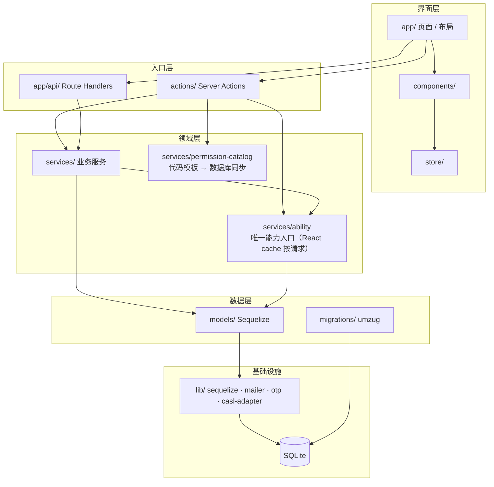

目标依赖规则：

- `actions` 不再直接操作模型，只调用 `services`；
- `lib` 不感知 `models`（`BaseModel` 的通用扩展移入 `models/base.ts`）；
- `store` 不直连外部服务；菜单由 RSC 读取 `services/menu`（全局定义 + 能力过滤 + 用户偏好）后注入初始状态，Redux 只保存折叠等 UI 状态；
- 权限模板与种子从模型文件移出，集中到 `services/permission-catalog`。

### 10.3 目标授权链路

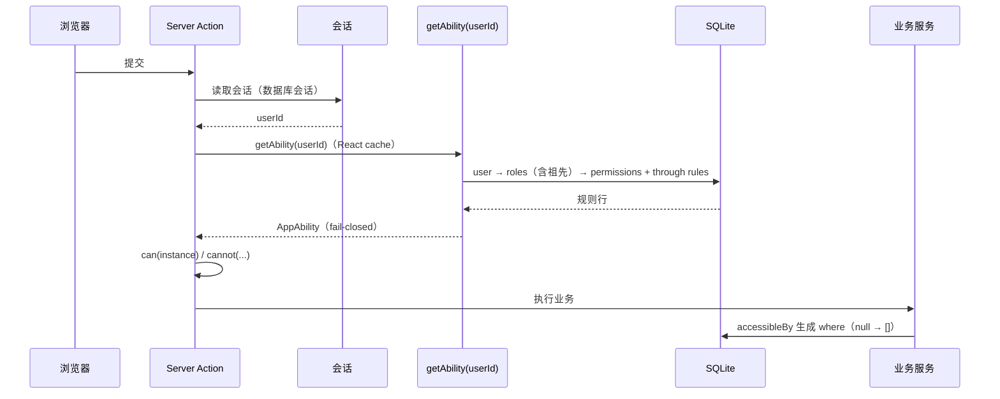

目标数据模型调整（ER 变化）：

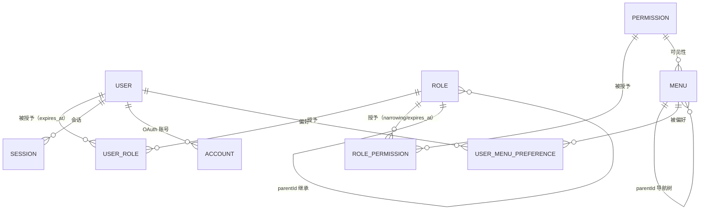

- `menus`：去掉 `user_id`，改为全局定义，关联 `permission_id`，保留 `parent_id/sort`；侧边栏 = 菜单定义 ∩ `getAbility(userId)`。
- `user_menu_preferences`：`(user_id, menu_id)` 复合主键，`favorite`、`sort`、`hidden`；只影响展示，不影响授权。
- `permissions`：只保留目录元数据（`action/subject/name/description/is_builtin`），`action/subject` 非空且 `UNIQUE(action, subject)`；不收窄规则。
- `role_permissions`：复合主键 `(role_id, permission_id)`，`narrowing JSON`（`{ fields?, conditions?, inverted? }`）+ `expires_at DATETIME` 作为「授予时收紧」；`narrowing` 用 zod 校验，解析失败 fail-closed。
- `user_roles`：复合主键 `(user_id, role_id)`，`expires_at`。
- 权限目录由代码模板 upsert 同步，管理页只能授予/收紧，不能散造 action/subject。
- 角色继承在能力构建时展开（父角色权限向下继承，子角色的拒绝规则优先）。

### 10.4 现状 vs 目标对照

| 维度       | 现状                    | 目标                                  |
| ---------- | ----------------------- | ------------------------------------- |
| 能力构建   | 两条路径，业务用空能力  | 一条 `getAbility(userId)`，请求级缓存 |
| 规则存储   | JSON 形状不一，字段丢失 | 强类型 `narrowing` JSON + zod 校验    |
| 数据过滤   | `where: null` 全表      | `null` → 空结果；查询统一走适配器     |
| 角色层级   | 有 `parent_id`，未使用  | 构建能力时继承                        |
| 权限目录   | 三处来源                | 代码模板同步进库                      |
| 表结构演进 | `sync({ force: true })` | umzug 迁移；种子只填数据              |
| 分层       | actions 直连 models     | actions → services → models           |
| 实验代码   | `/rsc`、`/dev` 等留存   | 移入 `examples/` 或删除               |
| 运维       | 健康检查 + 回滚         | 追加备份、日志级别、环境变量校验      |

### 10.5 授权语义（实施前定死的契约）

**数据过滤必须是三态**，不能用 `null` 同时表示两种含义：

| 能力状态                            | 适配器输出         | 语义     |
| ----------------------------------- | ------------------ | -------- |
| 没有任何 allow 规则                 | `'none'` → 空结果  | 无权限   |
| allow 规则无条件（如 `manage all`） | `'all'` → 不加条件 | 全部记录 |
| 有带条件的 allow 规则               | Sequelize `where`  | 条件过滤 |

`AbilityService.accessibleBy` 与 `lib/casl.accessibleBy` 合并为一个适配器，返回 `{ where }`、空集或全量；调用方不得自己解释 `null`。

**多角色与规则合并**：

- 多角色取并集：任一角色允许即可；
- 拒绝（`inverted` / `cannot`）优先于允许，与角色顺序无关；
- `manage` 是 `all` 的简写，跟随 CASL 语义；条件规则必须用 `subject('Role', instance)` 判断，不允许对 subject 字符串判断带条件规则；
- `expires` 在构建能力时按 `Date.now()` 过滤（数据库存 UTC），过期的 `user_roles` / `role_permissions` 直接跳过，不参与并集；
- 角色继承：先展开祖先角色的允许规则，再叠加当前角色与授予层的收紧规则；父角色的拒绝规则不向下传递（默认判断，可在实施时调整）。

**授权检查的覆盖面（Phase 0 的边界）**：

- 所有会写数据的 Server Action 与 Route Handler 必须做能力检查；
- 页面读取的授权在 Phase 2 把读取收口到 `services` 后统一执行；Phase 0 至少保证列表页不因能力为空而泄露（若当前页面本身只做展示，可延后）；
- `src/proxy.ts` 只作为登录态粗筛，不承担授权；matcher 是否扩展到 `/api`、`/profile` 在 Phase 0 一并决定。

### 10.6 迁移与发布流程

- 迁移文件用纯 JS/TS 编写并由 umzug 执行，随发布包一起上传（`migrations/` + 轻量 runner）；
- 执行时机：解包新 release 后、切换 `current` 软链前，依次执行 `node run-migrations.js` 与 `node sync-catalog.js`（目录 upsert）；迁移只向前（roll forward），代码回滚不回滚 schema；任一步失败即中止本次部署；
- 每次迁移前复制 `database.sqlite` 到 `APP_ROOT/backups/`，保留最近 N 份；
- 首次引入 umzug 时以「当前模型定义」生成基线迁移：目标服务器目前没有需要保留的数据，基线直接建表；本地 `database.sqlite` 视为可重建的开发数据，`bun run db:seed` 重建即可，不做数据迁移。

### 10.7 内置角色与角色授予

| 角色   | 权限                                                         |
| ------ | ------------------------------------------------------------ |
| 拥有者 | `manage all`                                                 |
| 管理员 | 用户、角色、权限的增删改查（`User` / `Role` / `Permission`） |
| 成员   | 只读（`read` 上述 subject）                                  |

- 权限目录仍由代码模板定义；上表是模板中三个内置角色的授予集合，写入数据库时表现为 `role_permissions` 行。
- 新用户通过账号密码注册、邮箱验证码首次登录、OAuth 首次登录时自动授予「成员」。
- 迁移时把创建时间最早的用户补授为「拥有者」；其余已有账号授予「成员」（目标库无存量数据时此步为空操作）。

---

## 11. 演进路线（阶段化，按风险排序）

### Phase 0：授权正确性（先止血）

1. 统一能力入口：实现 `getAbility(userId)`（DB 驱动 + `React.cache`），删除或改造 `defineAbilityFor`；
2. `accessibleBy` 改成三态契约（§10.5）；替换有损 `symbolize`；
3. `createFor` 读取 `through` 的 `rules`，按 `action+subject` 合并而非丢弃；展开角色继承与 `expires`；
4. 单条记录的权限判断改用 `subject()` 实例；
5. 所有写操作入口（Server Actions / Route Handlers）接入检查，替换目前只有 `updateRoleAction` 一处检查的现状；
6. 补授权测试：无规则、`manage all`、inverted、字段级、实例条件、多角色并集、过期授予。

> 前提：激活 fail-closed 能力入口前，必须存在「用户 → 角色」的授予路径（注册默认角色 + 已有账号的角色补授），否则所有人会立即失去权限。这是 Phase 0 的第 0 步，见 §14。

### Phase 1：数据层可控

1. 引入 umzug 迁移与基线（§10.6），`db:seed` 只负责种子数据；
2. 增加唯一约束/复合主键，清理重复授权；对齐本地库与模型的结构漂移；
3. `/permissions` 目录从代码模板 upsert；管理端只授予/收紧，不手造 action/subject（权限管理 UI 不在本阶段，先提供脚本入口）；
4. `expires` 语义迁移到授予层。

### Phase 2：结构清理

1. actions → services 收口（角色、用户、权限的读写操作）；RSC 页面的直接模型查询一并移入 `services`，读取授权在服务层统一执行；
2. `lib` 去除对 `models` 的反向依赖；
3. 菜单改为全局定义（关联权限）+ `user_menu_preferences`，移除 `MenuService` 对外部 `/menu` 的依赖，侧边栏由 RSC 过滤后注入；
4. 实验路由与死代码归档或删除；
5. 移除 `with-auth` 占位、双份 `accessibleBy`、`findManyWithAccessible`。

### Phase 3：可运维性

1. 环境变量 zod 校验（启动即失败）；
2. 定时备份 `database.sqlite` 并演练恢复；
3. 增加 `/api/health` 或复用现有探活，纳入部署健康检查；
4. 日志分级（当前 `log4js` 全量 debug）。

---

## 12. 非目标与触发条件

| 非目标            | 何时重新考虑                                                                              |
| ----------------- | ----------------------------------------------------------------------------------------- |
| monorepo 化       | 出现第二个可部署应用，或需要独立版本化的共享包                                            |
| 多租户 / 组织隔离 | 业务要求按组织隔离数据；届时给 `users/roles` 加 `organization_id` 并把条件纳入 CASL rules |
| 更换数据库        | SQLite 写入并发或数据量成为瓶颈                                                           |
| 容器化 / 集群     | 单机 pm2 无法满足可用性要求                                                               |
| 更换 UI 框架      | 出现面向 C 端、强 SEO/体积要求的页面（后台仍可保留 antd）                                 |

---

## 13. 我在文档中做的默认判断（供评审）

1. 继续使用数据库会话，不切 JWT；能力从 `userId` 构建，不在 token 中携带规则。
2. 角色层级采用「父角色权限向下继承」，拒绝规则以子角色/授予层为准；多角色取并集，拒绝优先（§10.5）。
3. 权限目录以代码为源，数据库为投影；管理页不允许新增 action/subject。
4. 迁移工具采用已安装的 umzug，而不是另引新库；迁移随发布包上传、切换软链前执行（§10.6）。
5. 实验路由不直接删除，先归档到 `examples/`（若你倾向直接删，可改）。
6. 目标部署形态保持单机 pm2，只补备份与监控，不上容器。
7. `accessibleBy` 采用三态契约，不再用 `null` 表示不同含义（§10.5）。
8. Phase 0 之前先接入角色授予路径（新用户默认「成员」、首个账号为「拥有者」），避免 fail-closed 后全员失权。
9. 权限管理 UI 不进 Phase 1，先以脚本完成目录同步；需要管理端编辑时再单独立项。
10. 收紧规则（`fields/conditions/inverted`）统一存强类型 JSON `narrowing`，不拆列；只有 `expires_at` 用真列。CASL 在内存消费规则，SQLite 里 JSON 就是 TEXT，拆列无查询收益；`conditions` 本就是嵌套对象，拆列会把一条规则拆散。
11. 菜单采用「全局定义 + 用户偏好」：`menus` 去 `user_id`、关联权限；收藏/排序/隐藏存 `user_menu_preferences`。侧边栏由 RSC 按能力过滤后注入，不再有 `/menu` 外部接口。
12. 权限目录在部署时显式同步：`deploy.sh` 在迁移之后、切换 `current` 之前执行 `sync-catalog`，失败即中止部署；本地开发由 `db:seed` 触发同一脚本。不在进程启动时 upsert，避免启动竞态和把漂移藏在日志里。

## 14. 待定问题

暂无。实施计划阶段若出现新的取舍，追加到本节。

> 范围已确认：四个阶段一起规划，实施顺序按 §11 逐阶段交付，每阶段可独立合并与部署。
